# Trabajo Práctico N°4: Bases de Datos y Manejo de Versiones

**16.22 - Informática Médica**
**Segundo Cuatrimestre 2026**

**Instituto Tecnológico de Buenos Aires (ITBA)**

**Integrantes:**
- Salerno Mato, Malena (64358)
- Yoo, Jana Gabriela (64412)
- Nemirovsky, Dalia (64061)

**Docentes:**
- Carlos Lazzarino
- Melina Leonor Piacentino Castaño
- Ingrid Celia Spessotti

**Fecha de Entrega:** 19/10/2026

---

# Parte 1 - Bases de Datos

## 1.1 Análisis de caso y construcción de base de datos para un centro médico

Cuando una persona acude al centro de salud, se le toma nota en una ficha con sus datos personales: nombre, fecha de nacimiento, sexo biológico y dirección (calle, número y ciudad). Esta ficha queda registrada en el archivo de pacientes del centro.

Los médicos del centro también tienen su ficha, donde se registran su nombre completo, especialidad y dirección profesional.

Cada vez que un médico realiza una consulta o tratamiento a un paciente, puede emitir una receta. Esta receta incluye la fecha, el nombre del paciente atendido, el médico que la emite, el medicamento o tratamiento indicado, y la enfermedad o condición que motivó la prescripción. Esta información queda registrada y organizada para facilitar tanto el seguimiento del paciente como las auditorías clínicas.

Los tratamientos pueden incluir medicamentos, indicaciones como reposo o fisioterapia, y suelen tener especificaciones temporales (por ejemplo, "tomar por 5 días" o "uso indefinido"). También se registran enfermedades o diagnósticos asociados, permitiendo análisis estadísticos o seguimiento epidemiológico.

El sistema busca reemplazar los registros en papel por una solución digital que permita realizar búsquedas rápidas, obtener estadísticas de distribución demográfica, sexo y especialidad, y mantener la información organizada para su integración con otros módulos médicos como historiales clínicos, turnos o recetas médicas.

Para comenzar con el diseño conceptual del modelo entidad-relación correspondiente al caso propuesto, se identificaron en primer lugar, mediante el uso de diferentes colores, las entidades, las relaciones y los atributos que lo componen. El código de colores utilizado es el siguiente: Entidades, Relaciones, Atributos.

En base a la descripción del caso propuesto, se trata de una base de datos relacional, diseñada a partir de un modelo entidad-relación. Asimismo, dado que se tiene como objetivo reemplazar los registros en papel por una solución digital que permita realizar búsquedas rápidas y mantener la información organizada para su integración con otros módulos médicos, su clasificación según su propósito es una base de datos transaccional (OLTP). Estas últimas están optimizadas para dar soporte al funcionamiento diario de las operaciones de una organización como un centro médico, como el registro de pacientes, médicos, recetas y tratamientos. Su objetivo central es registrar transacciones rápidas y seguras en tiempo real, garantizando la consistencia ante la interacción concurrente de múltiples usuarios. Cabe aclarar que el sistema también busca obtener estadísticas de distribución demográfica, sexo y especialidad, lo cual es propio de una base de datos analítica (OLAP). Sin embargo, como su función principal es registrar la información diaria del centro, se lo clasifica como transaccional.

### 1.1.2 Modelo Conceptual

Para visualizar la estructura de la base de datos, se plantea el modelo conceptual y se construye el diagrama entidad-relación correspondiente, utilizando la notación de Chen (Figura 1). En este diagrama, las entidades fuertes se representan con un rectángulo simple y las entidades débiles, que no pueden identificarse únicamente con sus propios atributos, con un rectángulo doble. Las relaciones se representan con rombos, y se utiliza un rombo doble para la relación identificadora de una entidad débil, es decir, aquella que la vincula con la entidad de la cual depende para ser identificada. La participación total se indica con una doble línea entre la entidad y la relación, y la participación parcial con una línea simple. Las claves primarias se subrayan con una línea continua y las claves parciales con una línea punteada. Por último, se indica la cardinalidad de cada relación (1:1, 1:N o M:N), colocando junto a cada entidad el número de instancias que pueden participar en ella.

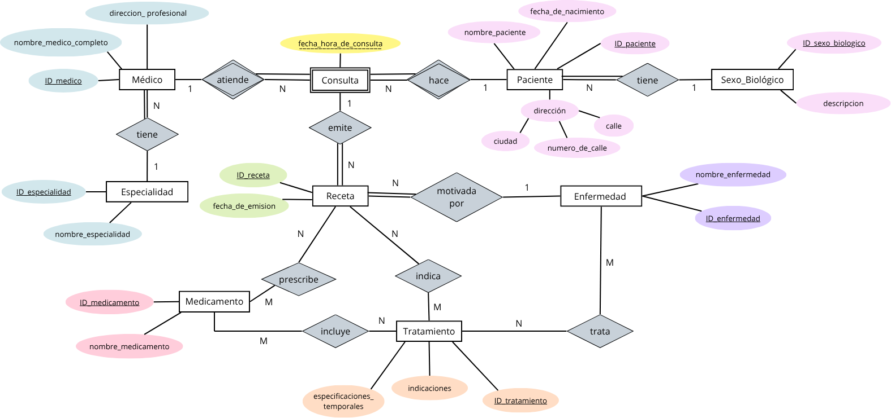

*Figura 1: Diagrama entidad-relación de la base de datos dada usando la notación de Chen. Para poder visualizarlo mejor ingresar al siguiente [link](https://www.canva.com/design/DAHYVcNP86k/UNnCDZEurgQh0hz9h3akYw/edit).*

***Nota:*** *Se incorporaron identificadores y atributos básicos (como la fecha y hora de la consulta y el nombre de la enfermedad) no explicitados en el enunciado, necesarios para identificar y describir cada entidad.*

En el modelo se distinguen dos clases de entidades según su mecanismo de identificación. Por un lado, las entidades fuertes (independientes): *Médico, Paciente, Enfermedad, Receta, Tratamiento, Medicamento, Sexo_Biológico* y *Especialidad*, las cuales poseen claves primarias unívocas. Por otro lado, la entidad débil (dependiente) *Consulta*, la cual se modeló de esta manera debido a que presenta una dependencia de existencia e identificación respecto a los datos del paciente y del médico. Esta entidad se discrimina mediante el atributo `fecha_hora_de_consulta`, el cual actúa como su clave parcial (subrayado con línea punteada).

En cuanto a los atributos, en su mayoría son simples (atómicos), a excepción del atributo *Dirección* en *Paciente*, el cual es compuesto y se desglosa en *calle*, *número_de_calle* y *ciudad*.

Con el objetivo de lograr un diseño más normalizado, se decidió modelar el sexo biológico y la especialidad médica como entidades independientes (*Sexo_Biológico* y *Especialidad*), en lugar de dejarlos como atributos de texto libre dentro de *Paciente* y *Médico*. Esta decisión evita inconsistencias en los datos, como errores de tipeo o distintas formas de escribir un mismo valor ("Cardiología" y "cardiologia", por ejemplo), y garantiza que cada valor se defina una sola vez y se reutilice mediante su identificador. Cada una de ellas se vincula con su entidad correspondiente mediante una relación 1:N, con participación total de *Médico* y de *Paciente*, ya que todo médico posee una especialidad y todo paciente un sexo biológico registrado.

Al analizar las relaciones, se destacan las siguientes reglas o características:

1. **Relaciones identificatorias:** las relaciones *atiende* y *hace* son de tipo identificatorio para la entidad *Consulta*, motivo por el cual se representan con un doble rombo.

2. **Participaciones:** la participación total (obligatoria) se representa gráficamente con doble línea conectando la entidad con el rombo de relación. Así, cada *Consulta* debe ser atendida obligatoriamente por un médico y pertenecer a un paciente. Lo mismo ocurre con *Receta*, que presenta participación total en *emite* (debe surgir de una consulta) y en *motivada por* (debe asociarse a una enfermedad). Del mismo modo, *Médico* y *Paciente* presentan participación total en las relaciones *tiene* con *Especialidad* y *Sexo_Biológico*, respectivamente, ya que todo médico posee una especialidad y todo paciente un sexo biológico registrado. En contraste, *Médico* y *Paciente* presentan participación parcial respecto de las consultas; y *Especialidad*, *Sexo_Biológico*, *Medicamento*, *Tratamiento* y *Enfermedad* presentan participación parcial en todas sus relaciones, pudiendo existir registrados en la base de datos sin estar asociados activamente a una consulta o receta en un momento determinado.

   Cabe destacar que las relaciones "prescribe" e "indica" que surgen de *Receta* se representan con participación parcial, ya que, de acuerdo con el enunciado, la receta incluye el medicamento ***o*** tratamiento indicado, es decir, no toda receta requiere ambos elementos. Sin embargo, como la notación de Chen no permite expresar la restricción de que cada receta tenga al menos uno de los dos, se dejan líneas simples y se aclara de forma textual.

3. **Cardinalidades:** un paciente puede realizar muchas consultas a lo largo del tiempo, perteneciendo cada consulta a un solo paciente (1:N). Un médico puede atender varias consultas, perteneciendo cada consulta a un solo médico (1:N). Una consulta puede generar cero o varias recetas, perteneciendo cada receta a una única consulta (1:N). Asimismo, una receta responde a un diagnóstico (*Enfermedad*, N:1) y puede prescribir múltiples medicamentos e indicar múltiples tratamientos (M:N). Cada médico posee una única especialidad, que puede ser compartida por muchos médicos (N:1), y cada paciente tiene un único sexo biológico, que puede repetirse entre muchos pacientes (N:1). Finalmente, el modelo contempla la relación M:N entre *Medicamento* y *Tratamiento* (incluye), y entre *Enfermedad* y *Tratamiento* (trata), reflejando la composición de los esquemas terapéuticos y las guías clínicas.

### 1.1.3 Modelo Relacional

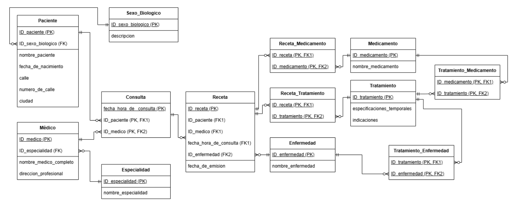

*Figura 2: Modelo relacional de la base de datos dada usando notación Crow's foot.*

A partir del diagrama de Chen, se construyó el modelo relacional en notación Crow's foot (***Figura 2***). Cada entidad se convirtió en una tabla con su clave primaria, y la dirección del paciente, que era un atributo compuesto, se separó en tres columnas: `calle`, `numero_de_calle` y `ciudad`. Además, sexo biológico y especialidad se modelaron como tablas de referencia (*Sexo_Biologico* y *Especialidad*), por lo que *Paciente* y *Médico* tienen una clave foránea que apunta a ellas en lugar de un campo de texto libre.

Las relaciones uno a muchos (*Paciente-Consulta, Médico-Consulta, Consulta-Receta, Enfermedad-Receta, Especialidad-Médico* y *Sexo_Biológico-Paciente*) se resolvieron agregando una clave foránea en la tabla del lado "muchos", que apunta a la clave primaria de la tabla del lado "uno". En cambio, las relaciones muchos a muchos (*Receta-Medicamento, Receta-Tratamiento, Tratamiento-Medicamento* y *Tratamiento-Enfermedad*) no pueden resolverse con una sola clave foránea, ya que, por ejemplo, una receta puede incluir varios medicamentos y un mismo medicamento puede aparecer en varias recetas. Por eso, cada una se transformó en una tabla intermedia, cuya clave primaria está formada por las dos claves foráneas.

Por otro lado, *Consulta*, que era la entidad débil del diagrama de Chen, tiene una clave primaria compuesta por su clave parcial (`fecha_hora_de_consulta`) y por las claves de las entidades de las que depende (`ID_paciente` e `ID_medico`). Por este motivo, *Receta* se vincula con *Consulta* mediante una clave foránea compuesta por esas tres columnas.

Finalmente, la cardinalidad mínima y máxima se indicó con los símbolos de Crow's foot. Del lado de las tablas referenciadas se usó "||" (uno y solo uno), porque cada consulta pertenece a un único médico y a un único paciente, cada receta a una única consulta y a una única enfermedad, y cada médico y paciente tiene una única especialidad y un único sexo biológico, respectivamente. Del lado de las claves foráneas se usó "o<" (cero o muchos), ya que, por ejemplo, un paciente puede no haber tenido consultas, una consulta puede no emitir ninguna receta, y una especialidad puede no tener médicos asociados todavía. Lo mismo vale para las tablas intermedias: una receta puede no tener medicamentos o no tener tratamientos, y un medicamento, tratamiento o enfermedad puede no estar asociado todavía a ninguna receta.

Por último, el enunciado indica que la receta incluye el medicamento ***o*** tratamiento indicado, lo que implica que cada receta debe estar asociada al menos a uno de los dos. Como esta restricción no puede expresarse en la notación Crow's foot, nuevamente solo se aclara de forma escrita.

## 1.2. Análisis de casos particulares y sus formas normales

### Caso 1

**PacienteInfo**

| PacienteID (PK) | Nombre | Teléfonos  |
|-----------------|--------|------------|
| 1               | Ana    | 1111, 2222 |
| 2               | Juan   | 3333       |

*Tabla 1: Caso 1 - PacienteInfo.*

En este caso se viola la 1FN, ya que en la celda correspondiente a *Teléfonos* para el paciente con *PacienteID = 1* hay más de un valor (1111, 2222) en lugar de uno único. Es decir, *Teléfonos* es un atributo multivaluado. Al no cumplirse la 1FN, la tabla no califica para la evaluación de las siguientes formas normales (2FN, 3FN, etc).

La 1FN establece que solo puede haber estructuras primitivas en cada celda. Luego, para poder cumplir con la 1FN, se podría generar una tupla por cada valor del atributo multivaluado *Teléfonos*, de modo que cada celda contenga un único valor atómico.

### Caso 2

**PacienteInfo**

| PacienteID (PK) | Ciudad   | CódigoPostal |
|-----------------|----------|--------------|
| 1               | CABA     | 1000         |
| 2               | La Plata | 1900         |

*Tabla 2: Caso 2 - PacienteInfo.*

En este segundo caso, se cumple la 1FN (todos los valores son atómicos) y la 2FN (todos los atributos son totalmente dependientes de la clave primaria *PacienteID*). No obstante, se viola la 3FN al haber una dependencia transitiva entre atributos no claves. *Ciudad* depende de *CódigoPostal*, y *CódigoPostal* depende de *PacienteID*, de modo que *Ciudad* depende de la clave primaria sólo de forma indirecta (*PacienteID → CódigoPostal → Ciudad*).

Para poder cumplir con la 3FN, se separa la tabla en dos: una tabla *Paciente*, con *PacienteID* como PK y *CódigoPostal* como atributo, que además es FK y referencia a la tabla *CodigoPostal*; y una tabla *CodigoPostal*, con *CódigoPostal* como PK y *Ciudad* como atributo. De este modo, cada atributo no clave depende únicamente de la clave primaria de su tabla, y se elimina la dependencia transitiva.

### Caso 3

**AtencionPacienteMedico**

| PacienteID (PK) | MédicoID (PK) | NombrePaciente | Especialidad |
|-----------------|---------------|----------------|--------------|
| 1               | 10            | Ana            | Pediatría    |
| 2               | 20            | Juan           | Cardiología  |

*Tabla 3: Caso 3 - AtencionPacienteMedico.*

En el caso 3 se tiene la tabla *AtencionPacienteMedico*, cuya clave primaria es compuesta y está formada por *PacienteID* y *MédicoID*. Dado que todos los valores de las celdas son atómicos, se cumple la 1FN. Sin embargo, no se cumple la 2FN, ya que existen dependencias parciales: el atributo *NombrePaciente* depende únicamente de *PacienteID*, y el atributo *Especialidad* depende únicamente de *MédicoID*, es decir, ambos dependen de una parte de la clave primaria y no de la clave completa.

Esto se solucionaría separando la tabla en: una tabla *Paciente*, con *PacienteID* como PK y el atributo *NombrePaciente*; una tabla *Médico*, con *MédicoID* como PK y el atributo *Especialidad*; y luego, la tabla *AtencionPacienteMedico*, una tabla intermedia que relaciona al paciente con su médico. De este modo cada atributo depende de la clave primaria completa de su tabla y se conserva la relación entre pacientes y médicos.

### Caso 4

**ConsultasPaciente**

| PacienteID | Enfermedad | Medicamento |
|------------|------------|-------------|
| 1          | Gripe      | Paracetamol |
| 1          | Gripe      | Ibuprofeno  |
| 1          | Diabetes   | Paracetamol |
| 1          | Diabetes   | Ibuprofeno  |

*Tabla 4: Caso 4 - ConsultasPaciente.*

Por último, en el caso 4 se cumplen la 1FN, la 2FN y la 3FN, pero se viola la 4FN. Esto se debe a que existen dos dependencias multivaluadas independientes entre sí: *PacienteID → Enfermedad* y *PacienteID → Medicamento*. Un mismo paciente tiene varias enfermedades y varios medicamentos, y como ambos conjuntos son independientes, es necesario almacenar todas las combinaciones posibles, lo que genera redundancia.

Se puede cumplir con la 4FN separando la tabla *ConsultasPaciente* en dos: una tabla *PacienteEnfermedad*, con *PacienteID* y *Enfermedad* como PK compuesta, y otra tabla *PacienteMedicamento*, con *PacienteID* y *Medicamento* como PK compuesta.

---

# Parte 2 - SQL

En esta sección se especifican las querys realizadas para cada una de las situaciones solicitadas.

### 1. Cuando se realizan consultas sobre la tabla paciente agrupando por ciudad los tiempos de respuesta son demasiado largos. Proponer mediante una query SQL una solución a este problema.

Para solucionar este problema se implementa un índice realizando una query de la siguiente manera:

```sql
CREATE INDEX idx_ciudad ON pacientes(ciudad);
```

No obstante, dado que esta base de datos es pequeña no se puede evidenciar el cambio en la velocidad de respuesta. Ahora bien, si se estuviera trabajando con una mayor cantidad de datos, el cambio entre implementar y no implementar un índice sí sería notorio.

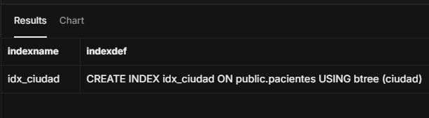

*Figura 3: Resultado de la query 1.*


### 2. Se tiene la fecha de nacimiento de los pacientes. Se desea calcular la edad de los pacientes y almacenarla de forma dinámica en el sistema ya que es un valor típicamente consultado, junto con otra información relevante del paciente.

```sql
CREATE VIEW vista_pacientes_con_edad AS
SELECT
    p.id_paciente,
    p.nombre AS nombre_paciente,
    p.fecha_nacimiento,
    EXTRACT(YEAR FROM AGE(CURRENT_DATE, p.fecha_nacimiento))::INT AS edad,
    sb.descripcion AS sexo,
    p.calle,
    p.numero,
    p.ciudad
FROM Pacientes p
LEFT JOIN SexoBiologico sb ON p.id_sexo = sb.id_sexo;
```

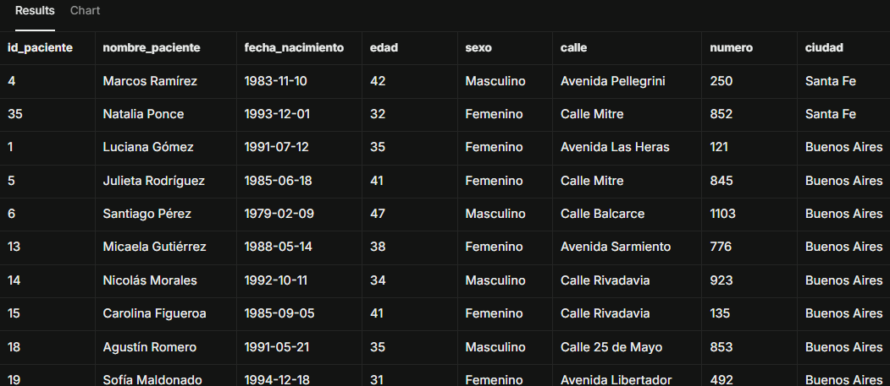
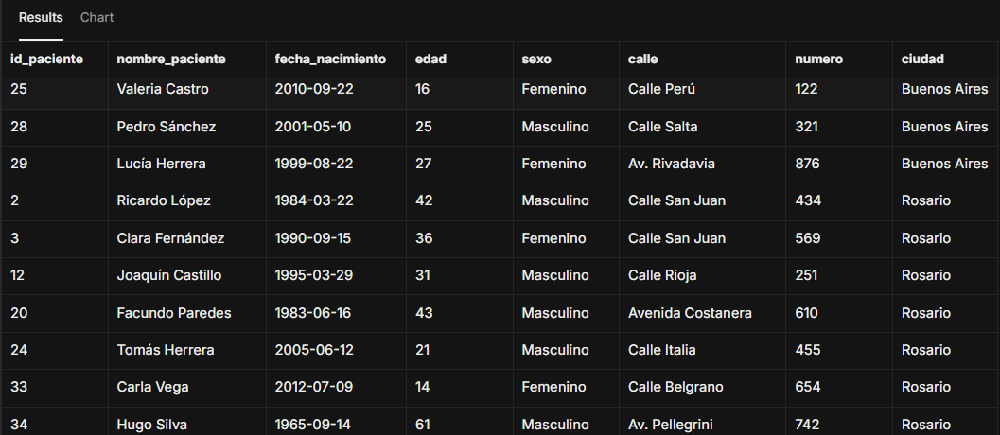
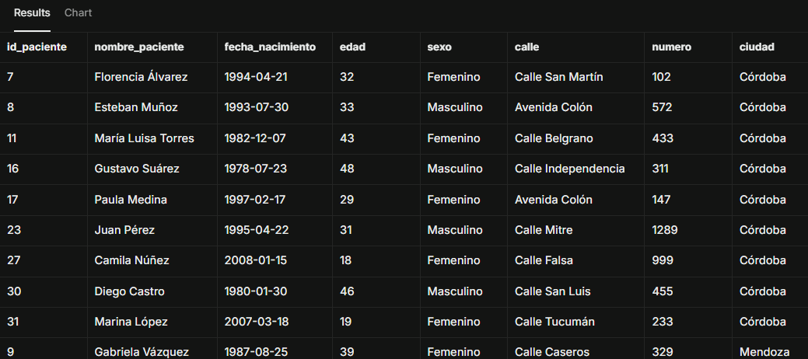
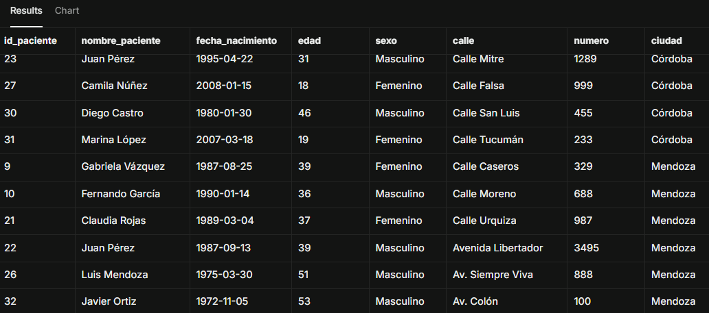

*Figuras 4, 5, 6 y 7: Resultado de la query 2.*

### 3. Obtener nombre y edad de pacientes menores de edad.

```sql
SELECT nombre_paciente, edad
FROM vista_pacientes_con_edad
WHERE edad < 18;
```

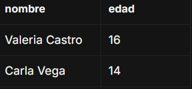

*Figura 8: Resultado de la query 3.*

### 4. La paciente, "Luciana Gómez", ha cambiado de dirección. Antes vivía en "Avenida Las Heras 121" en "Buenos Aires", pero ahora vive en "Calle Corrientes 500" en "Buenos Aires". Actualizar la dirección de este paciente en la base de datos.

```sql
UPDATE pacientes
SET calle = 'Calle Corrientes', numero = '500'
WHERE nombre = 'Luciana Gómez'
  AND calle = 'Avenida Las Heras'
  AND numero = '121'
  AND ciudad = 'Buenos Aires';
```


*Figura 9: Resultado de la query 4.*

### 5. Obtener el nombre y la dirección de los pacientes que viven en Buenos Aires.

```sql
SELECT nombre, calle, numero, ciudad
FROM pacientes
WHERE ciudad ILIKE '%buenos aires%' OR ciudad ILIKE '%bs%aires%';
```

o

```sql
SELECT nombre, calle, numero, ciudad
FROM pacientes
WHERE ciudad ILIKE '%B%A___s%';
```

- `LIKE` distingue entre mayúsculas y minúsculas, `ILIKE` las ignora.
- Se usa `%` para indicar que contiene la palabra B y A___s.
- Se usa `_` para indicar la cantidad de caracteres. Pero debe empezar con A y terminar con s.

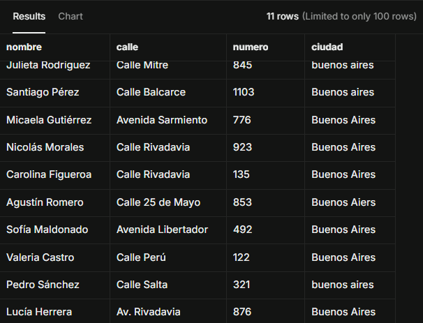

*Figura 10: Resultado de la query 5.*

### 6. Puede pasar que haya inconsistencias en la forma en la que están escritos los nombres de las ciudades, ¿cómo se corrige esto? Agregar la query correspondiente.

Antes de actualizar, revisamos qué ciudades diferentes existen:

```sql
SELECT DISTINCT ciudad
FROM pacientes
ORDER BY ciudad;
```

Y ahora actualizamos para normalizar los nombres:

```sql
UPDATE pacientes
SET ciudad = 'Buenos Aires'
WHERE ciudad ILIKE '%B%A___s%';

UPDATE pacientes
SET ciudad = 'Rosario'
WHERE ciudad ILIKE '%rosario%';

UPDATE pacientes
SET ciudad = 'Córdoba'
WHERE ciudad ILIKE '%C_r___a%';

UPDATE pacientes
SET ciudad = 'Mendoza'
WHERE ciudad ILIKE '%Me____a%';
```


*Figura 11: Resultado de la query 6.*

### 7. Cantidad de pacientes por sexo que viven en cada ciudad.

```sql
SELECT
    p.ciudad,
    sb.descripcion AS sexo,
    COUNT(p.id_paciente) AS cantidad
FROM pacientes p
INNER JOIN sexobiologico sb ON sb.id_sexo = p.id_sexo
GROUP BY p.ciudad, sb.id_sexo, sb.descripcion
ORDER BY p.ciudad, sb.descripcion;
```

Previo a realizar esta query, corregimos el campo ciudad para agrupar las ciudades de manera correcta. Caso contrario, aparecían agrupaciones de ciudades dos veces.

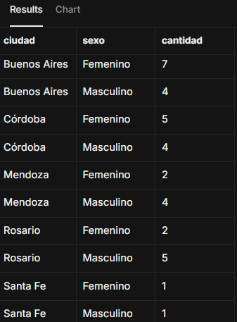

*Figura 12: Resultado de la query 7.*

### 8. Obtener todas las consultas médicas realizadas por el médico con ID igual a 3 durante el mes de agosto de 2024.

```sql
SELECT *
FROM consultas
WHERE id_medico = 3
  AND EXTRACT(MONTH FROM fecha) = 8
  AND EXTRACT(YEAR FROM fecha) = 2024;
```

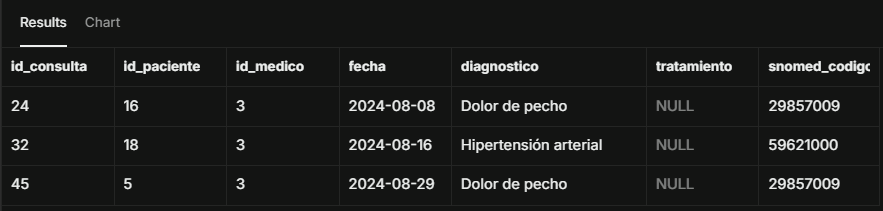

*Figura 13: Resultado de la query 8.*

### 9. Obtener la cantidad de recetas emitidas por cada médico.

```sql
SELECT m.nombre, COUNT(r.id_receta) AS cantidad_recetas
FROM medicos m
LEFT JOIN recetas r ON r.id_medico = m.id_medico
GROUP BY m.id_medico, m.nombre
ORDER BY cantidad_recetas DESC;
```

Se usa `LEFT JOIN` para traer todos los médicos aunque no hayan emitido recetas.


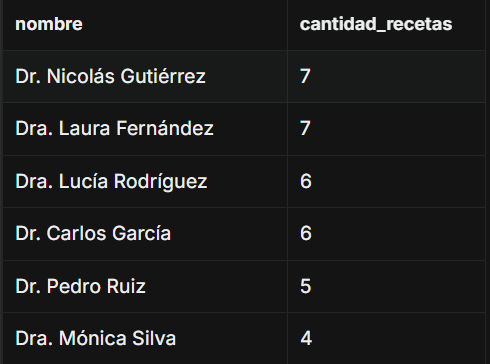
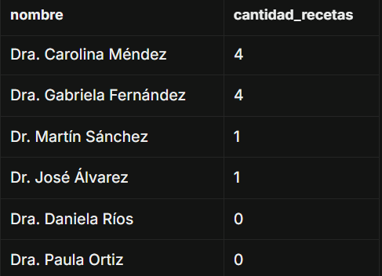
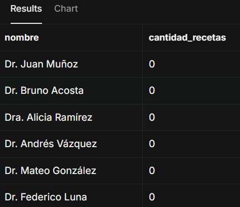
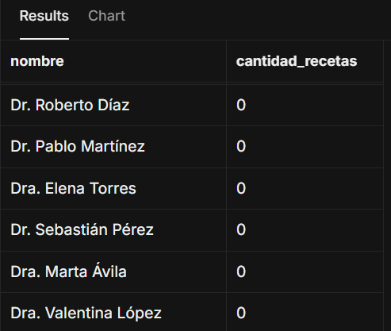

*Figuras 14, 15, 16 y 17: Resultado de la query 9.*

### 10. Obtener el nombre de los pacientes junto con la fecha y el diagnóstico de todas las consultas médicas realizadas en agosto del 2024.

```sql
SELECT p.nombre, c.diagnostico, c.fecha
FROM pacientes p
INNER JOIN consultas c ON p.id_paciente = c.id_paciente
WHERE EXTRACT(MONTH FROM c.fecha) = 8
  AND EXTRACT(YEAR FROM c.fecha) = 2024;
```

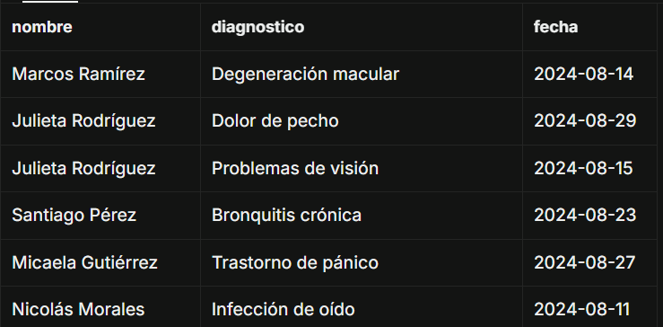
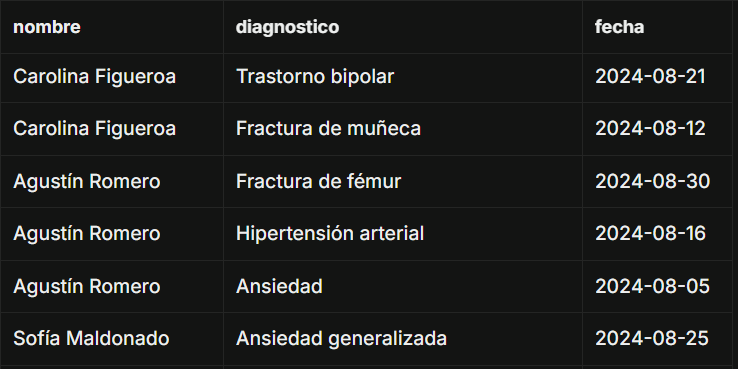
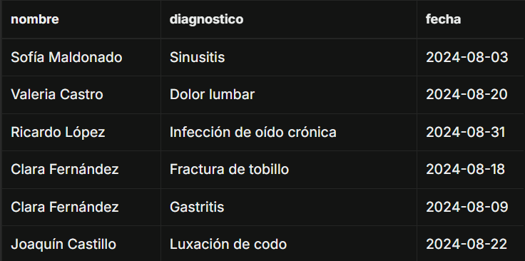
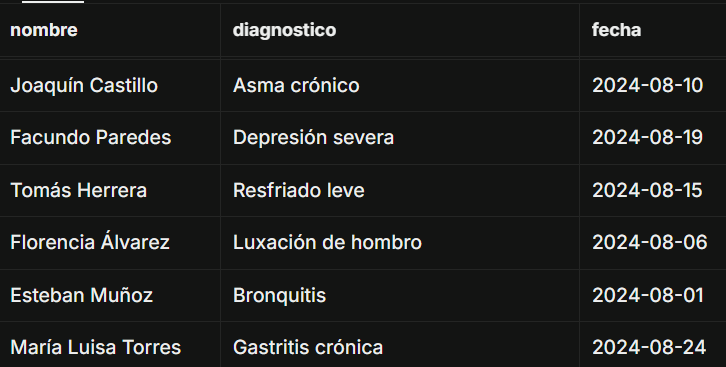
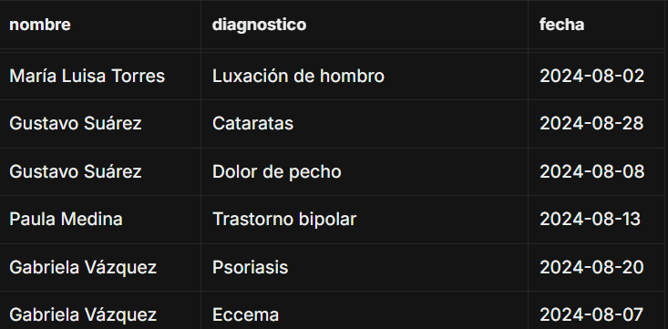
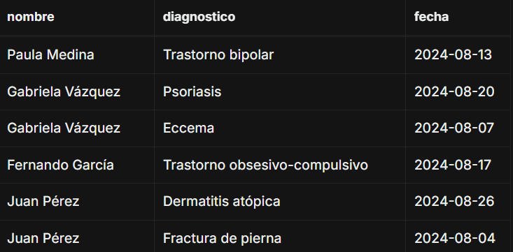

*Figuras 18, 19, 20, 21, 22 y 23: Resultado de la query 10.*

### 11. Obtener el nombre de los medicamentos prescritos más de una vez por el médico con ID igual a 2.

```sql
SELECT m.nombre, COUNT(r.id_medicamento) AS veces_prescriptas
FROM medicamentos m
INNER JOIN recetas r ON r.id_medicamento = m.id_medicamento
WHERE r.id_medico = 2
GROUP BY m.id_medicamento, m.nombre
HAVING COUNT(r.id_medicamento) > 1;
```


*Figura 24: Resultado de la query 11.*

### 12. Obtener el nombre de cada paciente junto con la cantidad total de recetas que ha recibido.

```sql
SELECT p.nombre, COUNT(r.id_receta) AS total_recetas
FROM pacientes p
LEFT JOIN recetas r ON p.id_paciente = r.id_paciente
GROUP BY p.id_paciente, p.nombre;
```

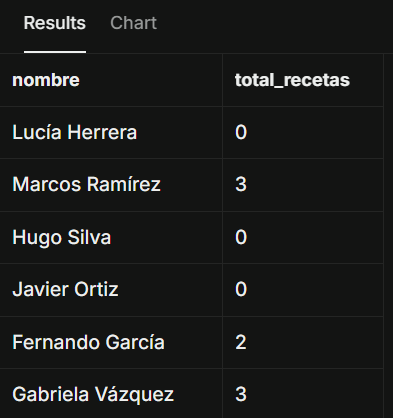
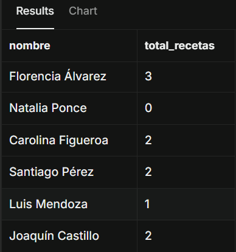
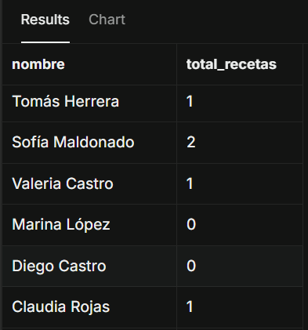
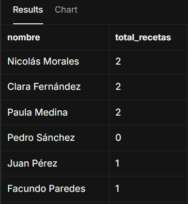
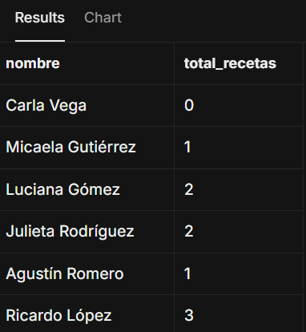
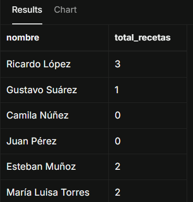

*Figuras 25, 26, 27, 28, 29 y 30: Resultado de la query 12.*

### 13. Obtener el nombre de cada especialidad y la cantidad de médicos que pertenecen a ella, mostrando únicamente aquellas especialidades que tienen más de 2 médicos.

```sql
SELECT e.nombre, COUNT(m.id_medico) AS total_medicos
FROM especialidades e
INNER JOIN medicos m ON m.especialidad_id = e.id_especialidad
GROUP BY e.id_especialidad
HAVING COUNT(m.id_medico) > 2;
```

En este caso no usamos `LEFT JOIN` porque luego en el `HAVING` filtramos por aquellos que sí tienen médicos. En caso de haber utilizado `LEFT JOIN`, primero se traerían todas las especialidades, incluso las que no tienen médicos, y luego filtraríamos por aquellas que sí. Por ende, es más eficiente usar `INNER JOIN` desde el principio.

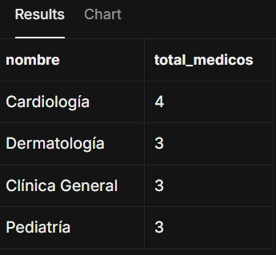

*Figura 31: Resultado de la query 13.*

### 14. Obtener el nombre y la edad de los pacientes cuya edad sea mayor al promedio de edad de todos los pacientes, ordenados de mayor a menor edad.

```sql
SELECT nombre_paciente, edad
FROM vista_pacientes_con_edad
WHERE edad > (SELECT AVG(edad) FROM vista_pacientes_con_edad)
ORDER BY edad DESC;
```
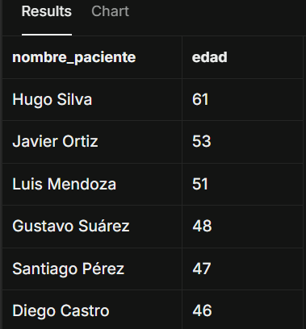
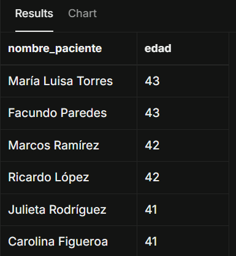
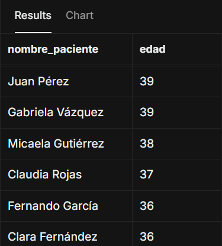

*Figuras 32, 33 y 34: Resultado de la query 14.*

### 15. Obtener los medicamentos que ocupan las dos primeras posiciones en cantidad de recetas emitidas, indicando para cada uno la cantidad de recetas.

```sql
SELECT m.nombre, COUNT(r.id_medicamento) AS cantidad_recetas
FROM medicamentos m
INNER JOIN recetas r ON r.id_medicamento = m.id_medicamento
GROUP BY m.nombre, m.id_medicamento
ORDER BY cantidad_recetas DESC
LIMIT 2;
```
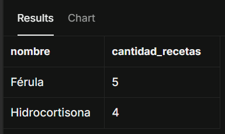

*Figura 35: Resultado de la query 15.*

### 16. Obtener el nombre del paciente junto con la fecha de su última consulta y el diagnóstico asociado.

```sql
WITH ultima_consulta AS (
    SELECT id_paciente, MAX(fecha) AS ultima_fecha
    FROM consultas
    GROUP BY id_paciente
)
SELECT p.nombre, c.diagnostico, c.fecha AS ultima_fecha
FROM pacientes p
INNER JOIN ultima_consulta u ON u.id_paciente = p.id_paciente
INNER JOIN consultas c ON c.id_paciente = u.id_paciente
                      AND c.fecha = u.ultima_fecha;
```

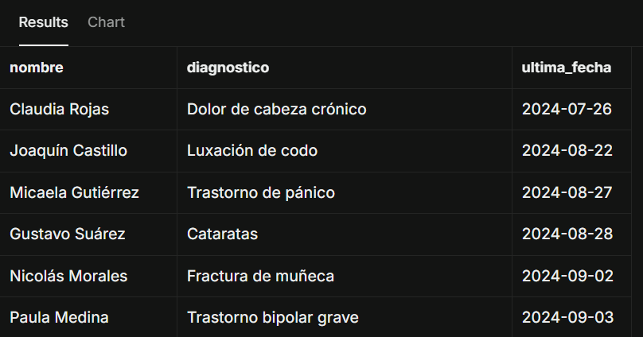
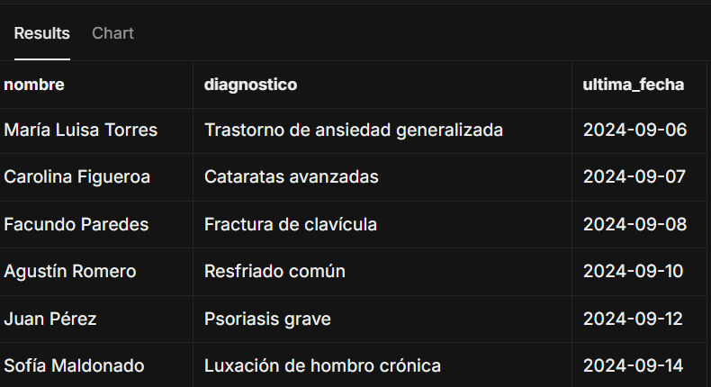
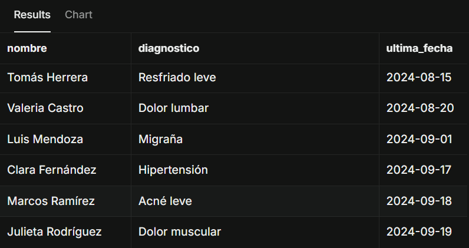

*Figuras 36, 37 y 38: Resultado de la query 16.*

### 17. Obtener el nombre del médico junto con el nombre del paciente y el número total de consultas realizadas por cada médico para cada paciente, ordenado por médico y paciente.

```sql
SELECT
    m.nombre AS nombre_medico,
    p.nombre AS nombre_paciente,
    COUNT(c.id_paciente) AS cantidad_consultas
FROM pacientes p
INNER JOIN consultas c ON c.id_paciente = p.id_paciente
INNER JOIN medicos m ON m.id_medico = c.id_medico
GROUP BY m.id_medico, p.id_paciente, m.nombre, p.nombre
ORDER BY m.nombre, p.nombre;
```

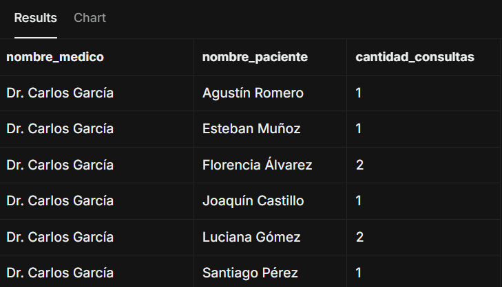
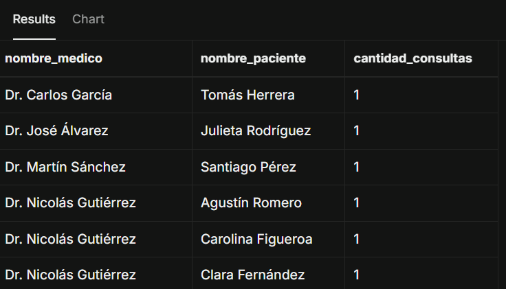
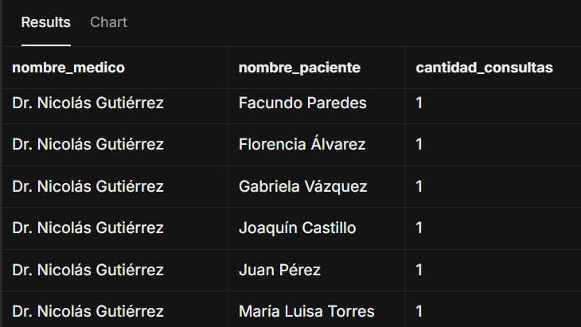
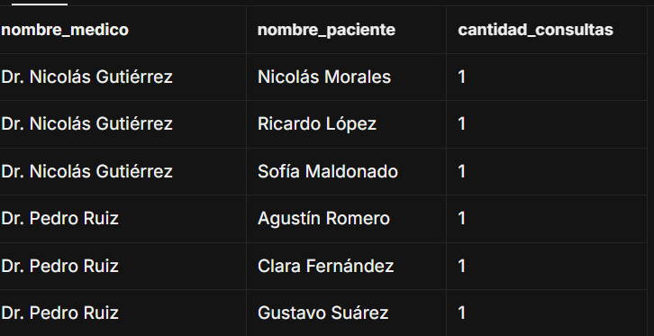
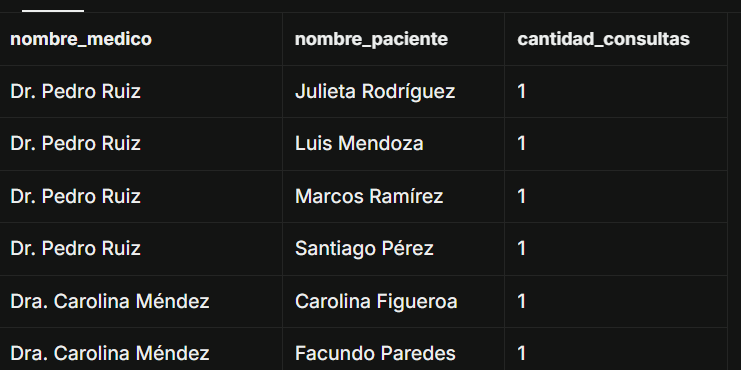
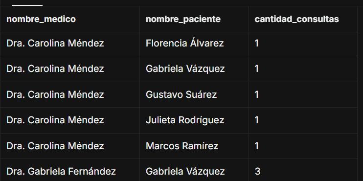
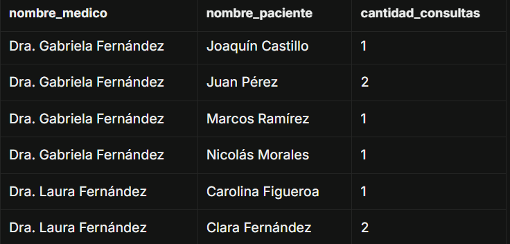
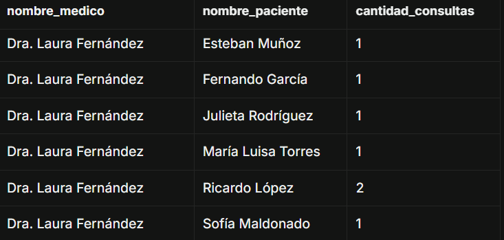
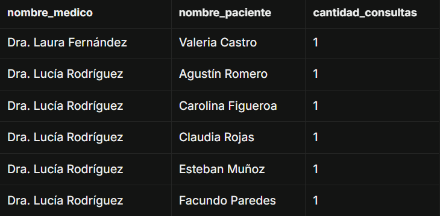
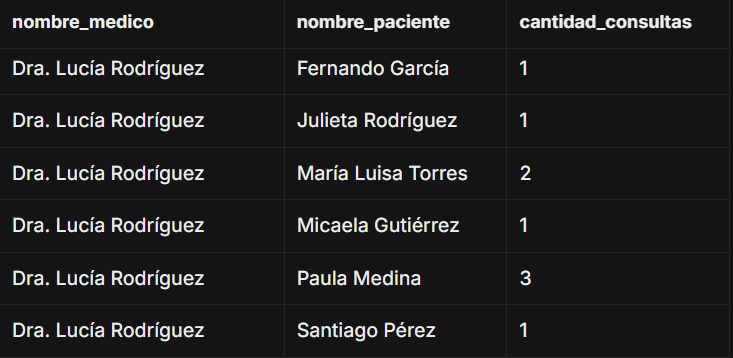
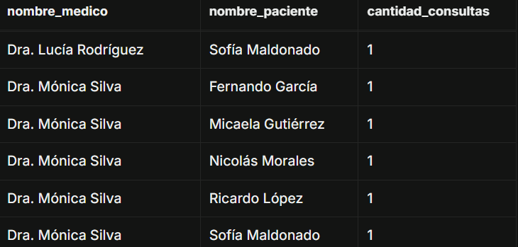

*Figuras 39, 40, 41, 42, 43, 44, 45, 46, 47, 48, 49 y 50: Resultado de la query 17.*

### 18. Obtener el nombre del medicamento junto con el total de recetas prescritas para ese medicamento, el nombre del médico que lo recetó y el nombre del paciente al que se le recetó, ordenado por total de recetas en orden descendente.

```sql
WITH total_por_medicamento AS (
    SELECT id_medicamento, COUNT(*) AS total_recetas
    FROM recetas
    GROUP BY id_medicamento
)
SELECT
    m.nombre AS nombre_medicamento,
    t.total_recetas,
    me.nombre AS nombre_medico,
    p.nombre AS nombre_paciente
FROM medicamentos m
INNER JOIN total_por_medicamento t ON t.id_medicamento = m.id_medicamento
INNER JOIN recetas r ON r.id_medicamento = m.id_medicamento
INNER JOIN medicos me ON me.id_medico = r.id_medico
INNER JOIN pacientes p ON p.id_paciente = r.id_paciente
ORDER BY t.total_recetas DESC, m.nombre;
```
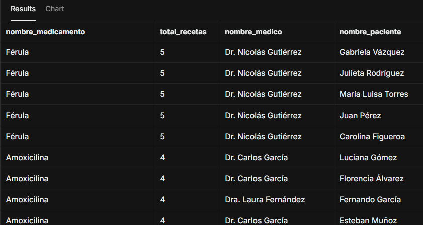
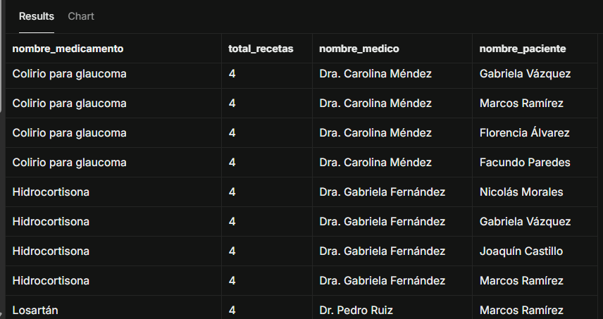
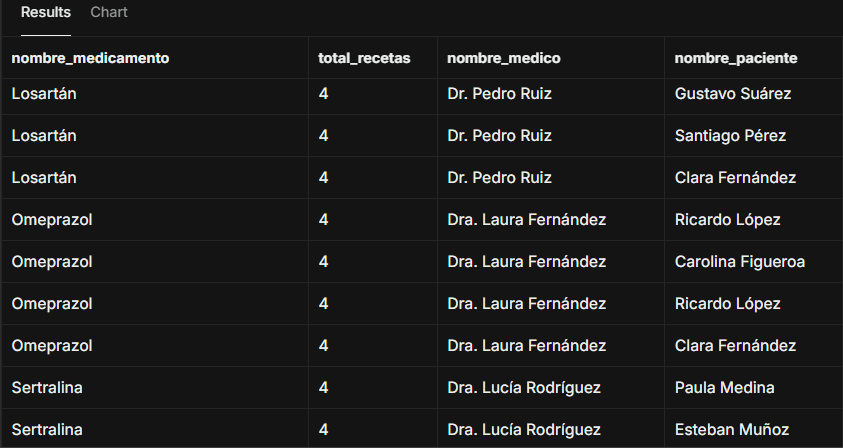
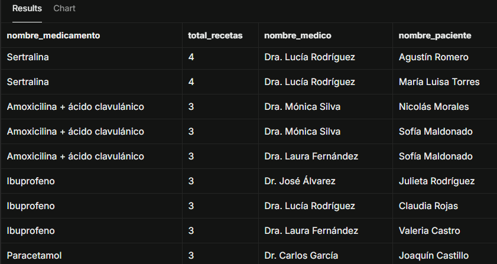


*Figuras 51, 52, 53, 54 y 55: Resultado de la query 18.*


### 19. Obtener el nombre del médico junto con el total de pacientes a los que ha atendido, ordenado por el total de pacientes en orden descendente.

```sql
SELECT m.nombre, COUNT(DISTINCT c.id_paciente) AS cantidad_pacientes
FROM medicos m
LEFT JOIN consultas c ON c.id_medico = m.id_medico
GROUP BY m.id_medico, m.nombre
ORDER BY cantidad_pacientes DESC;
```


*Figuras 56, 57 y 58: Resultado de la query 19.*

### 20. Obtener el nombre de cada médico junto con el número total de consultas realizadas por cada uno a pacientes menores de edad y una tercera columna que indique si el médico es pediatra (TRUE/FALSE).

```sql
SELECT
    m.nombre AS nombre_medico,
    COUNT(v.id_paciente) AS cantidad_consultas_menores,
    CASE
        WHEN m.especialidad_id = 1 THEN TRUE
        ELSE FALSE
    END AS es_pediatra
FROM medicos m
LEFT JOIN consultas c ON c.id_medico = m.id_medico
LEFT JOIN vista_pacientes_con_edad v ON v.id_paciente = c.id_paciente
                                    AND v.edad < 18
GROUP BY m.id_medico, m.nombre, m.especialidad_id;
```


*Figuras 59, 60 y 61: Resultado de la query 20.*